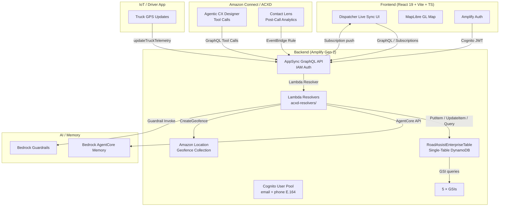
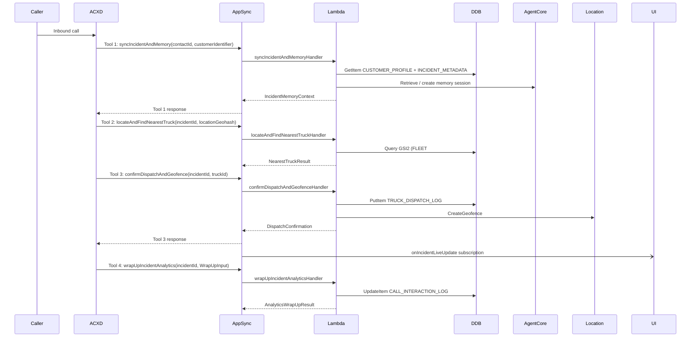

# Design Document

## Overview

Phase 1 of the **Road Assistance Agentic Call Center** establishes the production-grade scaffolding for an enterprise platform that connects customers requesting roadside assistance with the nearest available tow truck, all orchestrated by an AI agent integrated into Amazon Connect.

The platform is composed of two primary tiers:

1. **Frontend** — A React 19 + Vite + TypeScript single-page application that provides a Real-Time Live Sync dashboard to dispatchers and supervisors. It uses AWS Amplify UI components, MapLibre GL for interactive map rendering, Tailwind CSS for styling, and Amazon Chime SDK for voice/chat capabilities.

2. **Backend** — An AWS Amplify Gen 2 (`@aws-amplify/backend`) project that provisions all cloud infrastructure declaratively. It owns the AppSync GraphQL API, the Cognito User Pool, the single DynamoDB table (`RoadAssistEnterpriseTable`), five GSIs, Lambda resolver functions, an Amazon Location Geofence collection, and CDK L2 overrides for DynamoDB Streams and TTL.

The AI layer is driven by **Amazon Connect Agentic CX Designer (ACXD)**, which issues GraphQL tool calls against the AppSync API at four distinct points in the call lifecycle: call-start context sync, nearest-truck discovery, dispatch confirmation, and post-call wrap-up analytics. Bedrock AgentCore Memory provides cross-incident conversational memory, and Contact Lens supplies post-call transcription and sentiment analysis.

### Key Design Goals for Phase 1

- Establish a Single-Table DynamoDB schema that supports all six domain entity patterns and all five read access patterns without hot partitions.
- Expose a strongly-typed GraphQL API that is consumed identically by the React UI and ACXD tool calls.
- Ensure `npx ampx sandbox` compiles cleanly with stub Lambda resolvers — no business logic required in Phase 1.
- Apply CDK L2 overrides for DynamoDB Streams and TTL within Amplify Gen 2's escape-hatch pattern.

---

## Architecture

### High-Level Component Diagram



### Request Flow — ACXD Tool Calls



### Deployment Model

| Layer | Service | Provisioned By |
|---|---|---|
| Auth | Cognito User Pool | Amplify Auth resource |
| API | AppSync GraphQL | Amplify Data resource |
| Compute | Lambda (Node 20.x) | `defineFunction` in `amplify/functions/` |
| Data | DynamoDB Single Table | Amplify Data model + CDK overrides |
| Map / Geo | Amazon Location Service | CDK L1/L2 in `amplify/backend.ts` |
| AI Memory | Bedrock AgentCore Memory | External service; Lambda SDK calls |
| Analytics | Contact Lens | Amazon Connect; EventBridge rule triggers mutation |
| Frontend | S3 + CloudFront (or Amplify Hosting) | `amplify/` hosting config (Phase 2+) |

---

## Components and Interfaces

### 1. Frontend Components

| Component | Responsibility |
|---|---|
| `App.tsx` | Root component; wraps Amplify config, Authenticator, and router |
| `DispatcherDashboard.tsx` | Live Sync map view; subscribes to `onIncidentLiveUpdate` |
| `IncidentPanel.tsx` | Incident detail sidebar; renders AgentCore memory context |
| `TruckMap.tsx` | MapLibre GL map showing truck positions and geofences |
| `AuthWrapper.tsx` | `@aws-amplify/ui-react` `Authenticator` with email/phone toggle |
| `amplify_outputs.json` | Auto-generated Amplify outputs (not edited manually) |

### 2. Amplify Gen 2 Backend Modules

| File | Responsibility |
|---|---|
| `amplify/auth/resource.ts` | Cognito User Pool — email + phoneNumber login, custom attributes |
| `amplify/data/resource.ts` | AppSync schema — `RoadAssistRecord` model, Custom Types, queries, mutations, subscriptions, five GSIs |
| `amplify/backend.ts` | Root backend config — assembles auth + data + functions; CDK overrides for Streams + TTL |
| `amplify/functions/acxd-resolvers/<resolver>/handler.ts` | One stub Lambda handler per resolver (5 total) |
| `amplify/functions/acxd-resolvers/<resolver>/resource.ts` | `defineFunction` declaration per resolver |

### 3. AppSync Resolvers

Each resolver is a Lambda function configured with `a.handler.function()`. In Phase 1, all handlers return typed stub responses.

| Resolver | Type | Handler File |
|---|---|---|
| `syncIncidentAndMemory` | Query | `amplify/functions/acxd-resolvers/syncIncidentAndMemory/handler.ts` |
| `locateAndFindNearestTruck` | Query | `amplify/functions/acxd-resolvers/locateAndFindNearestTruck/handler.ts` |
| `confirmDispatchAndGeofence` | Mutation | `amplify/functions/acxd-resolvers/confirmDispatchAndGeofence/handler.ts` |
| `wrapUpIncidentAnalytics` | Mutation | `amplify/functions/acxd-resolvers/wrapUpIncidentAnalytics/handler.ts` |
| `updateTruckTelemetry` | Mutation | `amplify/functions/acxd-resolvers/updateTruckTelemetry/handler.ts` |

### 4. Key External Interfaces

| Interface | Protocol | Direction |
|---|---|---|
| ACXD ↔ AppSync | GraphQL / HTTPS + IAM SigV4 | ACXD → AppSync |
| Frontend ↔ AppSync | GraphQL / WSS (subscriptions) + HTTPS | Bidirectional |
| Lambda ↔ DynamoDB | AWS SDK v3 `DynamoDBDocumentClient` | Lambda → DDB |
| Lambda ↔ AgentCore | Bedrock AgentCore SDK (`@aws-sdk/client-bedrock-agent-runtime`) | Lambda → AgentCore |
| Lambda ↔ Location | `@aws-sdk/client-location` | Lambda → Location |
| EventBridge ↔ AppSync | HTTP GraphQL mutation | EventBridge → AppSync |
| IoT/Driver ↔ AppSync | GraphQL mutation + IAM | IoT → AppSync |

---

## Data Models

### Single-Table Design Overview

All domain entities share one DynamoDB table, `RoadAssistEnterpriseTable`, declared as a single Amplify model `RoadAssistRecord`. Entities are discriminated by the `entityType` string attribute and their `PK`/`SK` key patterns.

```mermaid
erDiagram
    RoadAssistRecord {
        string PK PK
        string SK SK
        string entityType
        json data
        int expiresAt
        string GSI1PK
        string GSI1SK
        string GSI2PK
        string GSI2SK
        string GSI3PK
        string GSI3SK
        string GSI4PK
        string GSI4SK
        string GSI5PK
        string GSI5SK
        string agentCoreMemoryId
        string agentCoreActorIdCustomer
        string agentCoreActorIdVehicle
        string agentCoreSessionId
        boolean guardrailIntervened
        string guardrailActionReason
        string guardrailIdAndVersion
        string llmChatSummary
        string contactLensGenAiSummary
        string sentimentLabel
        float sentimentScore
        float customerEffortScore
        string transcriptS3Uri
        string recordingS3Uri
    }
```

### Entity Key Patterns

| EntityType | PK Format | SK Format | Notes |
|---|---|---|---|
| `CUSTOMER_PROFILE` | `CUST#<CustomerID_or_Phone>` | `PROFILE` | CustomerID = UUID (≤36 chars) or E.164 phone |
| `CUSTOMER_VEHICLE` | `CUST#<CustomerID_or_Phone>` | `VEH#<PlateNumber>` | PlateNumber = 1–20 alphanumeric chars |
| `INCIDENT_METADATA` | `INC#<IncidentID>` | `METADATA` | IncidentID = ULID (26 chars) |
| `CALL_INTERACTION_LOG` | `INC#<IncidentID>` | `COMM#<ISO8601Timestamp>#<ContactID>` | ContactID = 1–64 chars; TTL set |
| `TOW_TRUCK_STATUS` | `TRUCK#<TruckID>` | `STATUS` | TruckID = 1–36 alphanumeric chars |
| `TRUCK_DISPATCH_LOG` | `TRUCK#<TruckID>` | `DISPATCH#<ISO8601Timestamp>#<IncidentID>` | TTL set |

### Global Secondary Indexes

| GSI | Name | PK Format | SK Format | Population Source | Access Pattern |
|---|---|---|---|---|---|
| GSI1 | `CustomerActiveIncidentIndex` | `CUST#<CustomerID_or_Phone>` | `STATUS#<IncidentStatus>#<CreatedAt>` | `INCIDENT_METADATA` | Active incidents by customer at call start |
| GSI2 | `FleetAvailabilityIndex` | `FLEET#<OperationalStatus>#<RegionZone>` | `TYPE#<TruckType>#<TruckID>` | `TOW_TRUCK_STATUS` | Pre-filter available trucks by region before route matrix call |
| GSI3 | `TruckActiveIncidentIndex` | `TRUCK#<TruckID>` | `ACTIVE#<IncidentID>` | Truck Assignment items (sparse) | Resolve incident context on geofence ENTER event |
| GSI4 | `OperationsControlIndex` | `OPS_STATUS#<IncidentStatus>` | `SEV#<Severity>#<UpdatedAt>` | Incident / ops status items | Dispatcher supervisor queue (eventually consistent) |
| GSI5 | `VehicleIncidentHistoryIndex` | `VEH#<PlateNumber>` | `STATUS#<IncidentStatus>#<CreatedAt>` | Vehicle Incident items (sparse) | Resolve incidents by license plate for unauthenticated callers |

All GSIs use `ALL` projection.

### AgentCore Memory Attributes (on `INCIDENT_METADATA`)

| Attribute | Type | Max Length | Required | Notes |
|---|---|---|---|---|
| `agentCoreMemoryId` | String | 256 | No | AgentCore memory resource ID |
| `agentCoreActorIdCustomer` | String | 256 | No | Customer actor correlation ID |
| `agentCoreActorIdVehicle` | String | 256 | No | Vehicle actor correlation ID |
| `agentCoreSessionId` | String | 256 | No | Must equal `incidentId` when provided |

### Guardrail + Contact Lens Telemetry Attributes (on `CALL_INTERACTION_LOG`)

| Attribute | Type | Constraint | Notes |
|---|---|---|---|
| `guardrailIntervened` | Boolean | — | Whether Bedrock Guardrail fired |
| `guardrailActionReason` | String | Max 512 chars | Human-readable reason |
| `guardrailIdAndVersion` | String | Format `<id>:<positiveInt>` | Guardrail ID and version |
| `llmChatSummary` | String | Max 4096 chars | LLM-generated call summary |
| `contactLensGenAiSummary` | String | Max 4096 chars | Contact Lens GenAI summary |
| `sentimentLabel` | String | — | e.g., `POSITIVE`, `NEGATIVE`, `NEUTRAL`, `MIXED` |
| `sentimentScore` | Float | 0.0 – 1.0 | Normalised sentiment confidence |
| `customerEffortScore` | Float | 0.0 – 10.0 | CES from Contact Lens |
| `transcriptS3Uri` | String | `s3://` prefix | S3 URI of call transcript |
| `recordingS3Uri` | String | `s3://` prefix | S3 URI of call recording |

### AppSync Custom Types

```typescript
// Declared with a.customType() in amplify/data/resource.ts

IncidentMemoryContext {
  incidentId: string
  customerId: string
  customerPhone: string
  membershipTier: string
  defaultPlate: string
  agentCoreMemoryId: string
  agentCoreActorIdCustomer: string
  agentCoreActorIdVehicle: string
  agentCoreSessionId: string
}

NearestTruckResult {
  truckId: string
  estimatedArrivalMinutes: integer   // whole minutes
  truckType: string
}

DispatchConfirmation {
  truckId: string
  incidentId: string
  geofenceStatus: string             // "CREATED" | "FAILED"
  dispatchTimestamp: string
}

AnalyticsWrapUpResult {
  incidentId: string
  success: boolean
  updatedFields: [string]
}

IncidentLiveUpdate {
  incidentId: string
  incidentStatus: string
  truckLocationGeohash: string
  etaMinutes: integer                // whole minutes
}

WrapUpInput {
  llmChatSummary: string
  contactLensGenAiSummary: string
  sentimentLabel: string
  sentimentScore: float
  customerEffortScore: float
  transcriptS3Uri: string
  recordingS3Uri: string
  guardrailIntervened: boolean
  guardrailActionReason: string
  guardrailIdAndVersion: string
}
```

### AppSync Operations

**Queries:**
```graphql
syncIncidentAndMemory(contactId: String!, customerIdentifier: String!): IncidentMemoryContext
locateAndFindNearestTruck(incidentId: String!, locationGeohash: String!): NearestTruckResult
```

**Mutations:**
```graphql
confirmDispatchAndGeofence(incidentId: String!, truckId: String!): DispatchConfirmation
wrapUpIncidentAnalytics(incidentId: String!, wrapUpInput: WrapUpInput!): AnalyticsWrapUpResult
updateTruckTelemetry(truckId: String!, locationGeohash: String!, operationalStatus: String!): Boolean
```

**Subscriptions:**
```graphql
onIncidentLiveUpdate(incidentId: String!): IncidentLiveUpdate
  @aws_subscribe(mutations: ["confirmDispatchAndGeofence", "updateTruckTelemetry"])
```

### Amplify Auth Configuration

```typescript
// amplify/auth/resource.ts
export const auth = defineAuth({
  loginWith: {
    email: true,
    phone: true,   // E.164 format enforced by Cognito
  },
  userAttributes: {
    'custom:membershipTier': { dataType: 'String', mutable: true, maxLen: 64, required: true },
    'custom:defaultPlate':   { dataType: 'String', mutable: true, maxLen: 20, required: true },
  },
});
```

### CDK L2 Overrides (`amplify/backend.ts`)

```typescript
// Apply after backend is assembled
const { amplifyDynamoDbTableWrapper } = backend.data.resources.tables['RoadAssistRecord'];
const cfnTable = amplifyDynamoDbTableWrapper.node.defaultChild as CfnTable;

if (!cfnTable) {
  throw new Error('RoadAssistRecord: CfnTable not found');
}

// Enable DynamoDB Streams
cfnTable.streamSpecification = { streamViewType: 'NEW_AND_OLD_IMAGES' };

// Enable TTL
cfnTable.timeToLiveSpecification = { attributeName: 'expiresAt', enabled: true };

// Export Stream ARN
new CfnOutput(stack, 'RoadAssistRecordStreamArn', {
  value: cfnTable.attrStreamArn,
});
```

### File and Directory Structure

```
road-assistance-call-center/
├── package.json                          # React 19, Vite, TS, Tailwind, aws-amplify, ...
├── vite.config.ts
├── tailwind.config.ts
├── tsconfig.json
├── tsconfig.node.json
├── index.html
├── src/
│   ├── main.tsx
│   ├── App.tsx
│   ├── index.css                         # @tailwind base/components/utilities
│   ├── components/
│   │   ├── AuthWrapper.tsx
│   │   ├── DispatcherDashboard.tsx
│   │   ├── IncidentPanel.tsx
│   │   └── TruckMap.tsx
│   └── amplify_outputs.json             # auto-generated
├── amplify/
│   ├── backend.ts                        # Root config + CDK L2 overrides
│   ├── auth/
│   │   └── resource.ts                   # Cognito User Pool config
│   ├── data/
│   │   └── resource.ts                   # AppSync schema, RoadAssistRecord, GSIs, custom types
│   └── functions/
│       └── acxd-resolvers/
│           ├── syncIncidentAndMemory/
│           │   ├── resource.ts           # defineFunction(...)
│           │   └── handler.ts            # stub handler
│           ├── locateAndFindNearestTruck/
│           │   ├── resource.ts
│           │   └── handler.ts
│           ├── confirmDispatchAndGeofence/
│           │   ├── resource.ts
│           │   └── handler.ts
│           ├── wrapUpIncidentAnalytics/
│           │   ├── resource.ts
│           │   └── handler.ts
│           └── updateTruckTelemetry/
│               ├── resource.ts
│               └── handler.ts
```

---

## Correctness Properties

*A property is a characteristic or behavior that should hold true across all valid executions of a system — essentially, a formal statement about what the system should do. Properties serve as the bridge between human-readable specifications and machine-verifiable correctness guarantees.*

### Property 1: CUSTOMER_PROFILE key round-trip

*For any* valid `CustomerID_or_Phone` (UUID ≤ 36 characters or E.164 phone number), constructing a `CUSTOMER_PROFILE` record with `PK = "CUST#<id>"` and `SK = "PROFILE"`, serialising it to a DynamoDB item, and deserialising it back SHALL yield an item whose `PK` begins with `"CUST#"`, whose `SK` equals `"PROFILE"`, and whose `entityType` equals `"CUSTOMER_PROFILE"`.

**Validates: Requirements 3.2**

### Property 2: INCIDENT_METADATA key round-trip

*For any* valid ULID string of exactly 26 characters, constructing an `INCIDENT_METADATA` record with `PK = "INC#<ulid>"` and `SK = "METADATA"`, serialising it to a DynamoDB item, and deserialising it back SHALL yield an item whose `PK` begins with `"INC#"`, whose `SK` equals `"METADATA"`, and whose `entityType` equals `"INCIDENT_METADATA"`.

**Validates: Requirements 3.4**

### Property 3: CALL_INTERACTION_LOG SK sort-order preservation

*For any* two `CALL_INTERACTION_LOG` records sharing the same `PK` (`INC#<IncidentID>`), the lexicographic order of their `SK` values (`COMM#<ISO8601Timestamp>#<ContactID>`) SHALL equal the chronological order of their timestamps — i.e., earlier events sort before later events.

**Validates: Requirements 3.5**

### Property 4: TTL population invariant

*For any* `RoadAssistRecord` item, if its `entityType` is `CALL_INTERACTION_LOG` or `TRUCK_DISPATCH_LOG`, then its `expiresAt` attribute SHALL be present and SHALL be a positive integer; if its `entityType` is `CUSTOMER_PROFILE`, `CUSTOMER_VEHICLE`, `INCIDENT_METADATA`, or `TOW_TRUCK_STATUS`, then its `expiresAt` attribute SHALL be absent.

**Validates: Requirements 3.8**

### Property 5: GSI1 key population invariant

*For any* `INCIDENT_METADATA` record, the `GSI1PK` attribute SHALL be a non-empty string matching the pattern `CUST#<CustomerID_or_Phone>` and `GSI1SK` SHALL match the pattern `STATUS#<IncidentStatus>#<CreatedAt>`.

**Validates: Requirements 3.9**

### Property 6: GSI2 key population invariant

*For any* `TOW_TRUCK_STATUS` record, the `GSI2PK` attribute SHALL match the pattern `FLEET#<OperationalStatus>#<RegionZone>` and `GSI2SK` SHALL match the pattern `TYPE#<TruckType>#<TruckID>`.

**Validates: Requirements 3.10**

### Property 7: AgentCore session ID consistency

*For any* `INCIDENT_METADATA` record where `agentCoreSessionId` is provided, `agentCoreSessionId` SHALL equal the `incidentId` extracted from `PK` (i.e., `PK.replace("INC#", "")`).

**Validates: Requirements 5.1, 5.4**

### Property 8: Guardrail ID-and-version format invariant

*For any* `CALL_INTERACTION_LOG` record where `guardrailIdAndVersion` is present, the value SHALL match the pattern `<nonEmptyString>:<positiveInteger>` — specifically, it SHALL contain exactly one colon separator, the part before the colon SHALL be non-empty, and the part after the colon SHALL parse as an integer greater than zero.

**Validates: Requirements 5.2**

### Property 9: Sentiment score bounds invariant

*For any* `CALL_INTERACTION_LOG` record where `sentimentScore` is present, the value SHALL be a float in the closed interval [0.0, 1.0]; and where `customerEffortScore` is present, the value SHALL be a float in the closed interval [0.0, 10.0].

**Validates: Requirements 5.3**

### Property 10: S3 URI format invariant

*For any* `CALL_INTERACTION_LOG` record where `transcriptS3Uri` or `recordingS3Uri` is present, each URI SHALL begin with the prefix `"s3://"` and SHALL contain at least one additional non-empty character after the prefix.

**Validates: Requirements 5.3**

### Property 11: updateTruckTelemetry geohash precision

*For any* invocation of the `updateTruckTelemetry` mutation, the `locationGeohash` argument SHALL be a string of exactly 6 characters, and `operationalStatus` SHALL be one of `AVAILABLE`, `DISPATCHED`, or `OFFLINE`.

**Validates: Requirements 6.8**

### Property 12: TRUCK_DISPATCH_LOG SK sort-order preservation

*For any* two `TRUCK_DISPATCH_LOG` records sharing the same `PK` (`TRUCK#<TruckID>`), the lexicographic order of their `SK` values (`DISPATCH#<ISO8601Timestamp>#<IncidentID>`) SHALL equal the chronological order of their dispatch timestamps.

**Validates: Requirements 3.7**

---

## Error Handling

### AppSync / GraphQL Layer

| Scenario | Behaviour |
|---|---|
| Unauthenticated request | AppSync returns `401 Unauthorized`; no data leaked |
| `syncIncidentAndMemory` — record creation fails | GraphQL error returned identifying which record type failed; partial records preserved for retry (Req 6.3) |
| `confirmDispatchAndGeofence` — geofence creation fails | `TRUCK_DISPATCH_LOG` is still written; `DispatchConfirmation.geofenceStatus` set to `"FAILED"` (Req 6.5) |
| Missing Cognito custom attribute on registration | Validation error returned naming each missing attribute (Req 2.5) |
| `agentCoreSessionId` mismatch | Write is rejected; error indicates session identifier mismatch (Req 5.4) |

### Lambda Resolver Layer

| Scenario | Behaviour |
|---|---|
| DynamoDB conditional check failure | Lambda propagates a structured error to AppSync resolver response |
| SDK throttling / transient error | Lambda retries with exponential backoff (configured per resolver in Phase 2) |
| Schema validation failure (wrong GSI key format) | Lambda throws synthesis-time or runtime error with descriptive message |

### CDK Synthesis Layer

| Scenario | Behaviour |
|---|---|
| `CfnTable` resource not found | `amplify/backend.ts` throws error: `"RoadAssistRecord: CfnTable not found"` (Req 8.4) |
| CloudFormation emits template without both overrides | Synthesis guard asserts `streamViewType` and `ttlAttribute` are set before template is emitted (Req 8.5) |

### TTL and Data Retention

`CALL_INTERACTION_LOG` and `TRUCK_DISPATCH_LOG` items carry an `expiresAt` Unix epoch timestamp. DynamoDB TTL asynchronously deletes expired items, providing eventual data retention enforcement without explicit delete operations.

---

## Testing Strategy

### Dual Testing Approach

This feature uses both **unit/example-based tests** and **property-based tests (PBT)**.

PBT is appropriate here because:
- Key-pattern construction functions are pure functions over string inputs with well-defined output invariants.
- Attribute validation rules (TTL presence, score bounds, URI format, geohash length) are universal properties that hold for all valid records.
- The input space for IDs, timestamps, and attribute values is large enough that 100+ randomised iterations surface edge cases that hand-crafted examples miss.

### Property-Based Testing Library

Use **[fast-check](https://github.com/dubzzz/fast-check)** for TypeScript. It integrates natively with Vitest and generates arbitrary inputs with shrinking support.

```bash
npm install --save-dev fast-check vitest @vitest/coverage-v8
```

Each property-based test MUST run a minimum of **100 iterations** (fast-check default is 100; configure `numRuns: 100` explicitly).

Tag format in test files:
```typescript
// Feature: road-assistance-call-center-phase1, Property <N>: <property_text>
```

### Unit / Example-Based Tests

Focus areas:
- Each entity key-construction function with a small set of concrete valid and invalid inputs
- `syncIncidentAndMemory` stub returns a response whose shape satisfies `IncidentMemoryContext`
- `confirmDispatchAndGeofence` stub returns a response whose shape satisfies `DispatchConfirmation`
- TypeScript compilation of all `amplify/` files (tested via `tsc --noEmit`)

### Property-Based Tests

Each correctness property defined above maps to exactly one `fc.property(...)` test in Vitest. Tests live in `src/__tests__/properties/` and `amplify/__tests__/properties/`.

| Test File | Properties Covered |
|---|---|
| `keyPatterns.property.test.ts` | Properties 1, 2, 3, 12 |
| `ttlInvariant.property.test.ts` | Property 4 |
| `gsiKeys.property.test.ts` | Properties 5, 6 |
| `agentCoreSession.property.test.ts` | Property 7 |
| `guardrailFormat.property.test.ts` | Property 8 |
| `scoreBounds.property.test.ts` | Property 9 |
| `s3UriFormat.property.test.ts` | Property 10 |
| `truckTelemetry.property.test.ts` | Property 11 |

### Integration Tests (Phase 2+)

- End-to-end GraphQL tool calls against a live Sandbox environment
- DynamoDB Stream event triggers (verifying `NEW_AND_OLD_IMAGES` payload)
- Geofence creation against a real Amazon Location collection
- Contact Lens EventBridge rule → `wrapUpIncidentAnalytics` mutation pipeline
